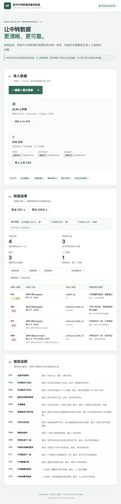

# 航司中转数据质量校验器

Air Transit Data Validator is a browser-only demo for validating fictional flight, passenger and baggage transfer data. It checks formats, duplicate keys, references and connection consistency without sending files to a server.

面向数据对接人员的通用演示工具。**所有样例均为虚构数据**，不包含姓名、证件号等个人信息。它不代表海关、机场或航司的正式接口标准，不保证符合任何真实生产接口，也不用于自动执法判断。导入文件仅在浏览器内存中处理，不会主动上传；不自动修改原始文件。



## 快速开始

需要 Node.js 22 或更高版本和 npm：

```sh
npm ci
npm run dev
npm run typecheck
npm test
npm run build
npm run preview
```

开发服务器地址以终端输出为准。生产构建输出在 `dist/`。应用采用相对资源路径，适用于 GitHub Pages 项目子路径；Pages 工作流需要在仓库设置中选择 GitHub Actions 作为部署来源。

选择一个包含三张工作表的 XLSX，或选择三份 UTF-8 CSV 并点击导入。也可一键载入虚构的混合错误样例。下载模板和样例，查看概览、筛选结果并导出完整报告。CSV 报告采用 UTF-8 BOM、标准引号转义，并为可能被表格软件当作公式的文本加单引号；JSON 保存原值和阈值。问题总数按规则命中计数；受影响记录按表、来源和原始行去重；错误和人工复核是按问题严重程度计数。筛选只影响显示，导出始终包含完整报告。

## 数据字典

每个字段均必填，无可为空条件。字段名严格区分大小写；额外列忽略。文本前后空格会被去除。所有标识均为区分大小写的字母、数字、下划线或短横线。`flight_id` 标识具体航班实例，不能仅用航班号推断实例。

| 表 | 字段 | 类型和格式 |
|---|---|---|
| flights | flight_id | 文本，实例主键 |
| flights | carrier | 2–3 位大写字母或数字 |
| flights | flight_number | 标识格式文本，演示航班号 |
| flights | departure_airport, arrival_airport | 3 位大写英文字母，仅校验格式，不验证真实机场存在性 |
| flights | scheduled_departure, scheduled_arrival | 文本，`YYYY-MM-DDTHH:mm[:ss[.SSS]]Z` 或 `±HH:mm`，必须带偏移；比较实际时刻 |
| passengers | passenger_id | 文本主键；样例使用 FICTIONAL 前缀 |
| passengers | inbound_flight_id, outbound_flight_id | 航班实例 ID |
| baggage | baggage_id | 文本主键，允许一个旅客对应多件行李 |
| baggage | passenger_id | 旅客 ID |
| baggage | inbound_flight_id, outbound_flight_id | 航班实例 ID |
| baggage | weight_kg | 大于零的十进制数字，单位 kg |

XLSX 的时间须是带时区的文本单元格，不能使用 Excel 日期或公式单元格。列缺失、文件损坏或工作表缺失时拒绝导入；空数据表允许，仅表头模板有效。

## 规则目录

每条规则的解释和修正建议也显示在界面及报告中。下面条件中涉及关联的规则仅在前置引用可以唯一确定且相关值有效时执行。

| 编号 | 名称 | 程度 | 触发条件及建议 |
|---|---|---|---|
| R01 | 必填字段缺失 | 错误 | 空值；填写字段 |
| R02 | 字段格式不合法 | 错误 | 标识、航司或机场代码不符合上述格式；修正格式 |
| R03 | 时间格式不合法 | 错误 | 日期无效或无时区；填写有效带偏移的时间 |
| R04 | 航班时间顺序错误 | 错误 | 到达不晚于出发；核对时间 |
| R05 | 主键重复 | 错误 | 同表主键多次出现；保证唯一 |
| R06 | 旅客航班引用无效 | 错误 | 引用不存在或重复导致不明确；核对航班 ID |
| R07 | 行李引用无效 | 错误 | 旅客或航班不存在或重复导致不明确；核对引用 |
| R08 | 两航段相同 | 错误 | 旅客入境与后续航班 ID 相同；核对航段 |
| R09 | 中转机场不一致 | 错误 | 前序到达与后续出发机场不一致；核对航段 |
| R10 | 中转时间顺序错误 | 错误 | 后续起飞不晚于前序到达；核对时间 |
| R11 | 行李航段不一致 | 错误 | 行李与唯一所属旅客的航段不一致；核对航段 |
| R12 | 行李重量无效 | 错误 | 非有效正数；修正重量 |
| R13 | 行李重量待复核 | 人工复核 | 超过可配置重量阈值；人工核对 |
| R14 | 中转间隔待复核 | 人工复核 | 正间隔低于最短或高于最长阈值；人工核对 |

默认阈值：32 kg、60 分钟、1440 分钟。这些只是演示参数，不是正式业务规定；超过阈值不等于业务违规。重复主键会导致关联不明确，报告列出关联位置，不会任意选择其中一行。缺少前置字段时跳过依赖该字段的判断。

## 虚构样例

- 正确样例和修正示例：无问题；包含同一旅客的两件行李。
- 混合错误样例：默认阈值下预计各一条 R07、R09、R11、R13。修正示例可直接下载，与正确样例相同。
- 边界样例：跨午夜、跨时区且按实际时刻中转 4 小时，默认阈值下无问题。

## 已知限制和路线

仅支持规定的三表结构、文本时间、CSV 与 XLSX；数据和结果都保存在内存，大文件可能使浏览器变慢。机场代码不进行权威库校验，阈值不覆盖真实业务规则，也不检查数据以外的上下文。依赖审计（2026-11-04）报告 ExcelJS 传递依赖 9 项中等风险，涉及 minimatch 和 uuid；部署前应评估依赖更新和不可信文件风险。后续可增加可配置字段映射、更多规则、分块处理及无障碍测试。

## 许可证

本项目自行编写的代码按 [MIT](LICENSE) 许可。第三方依赖分别适用其自身许可证，详见 `node_modules` 中各依赖的许可文件和 lockfile；发布时请保留其必要许可声明。
